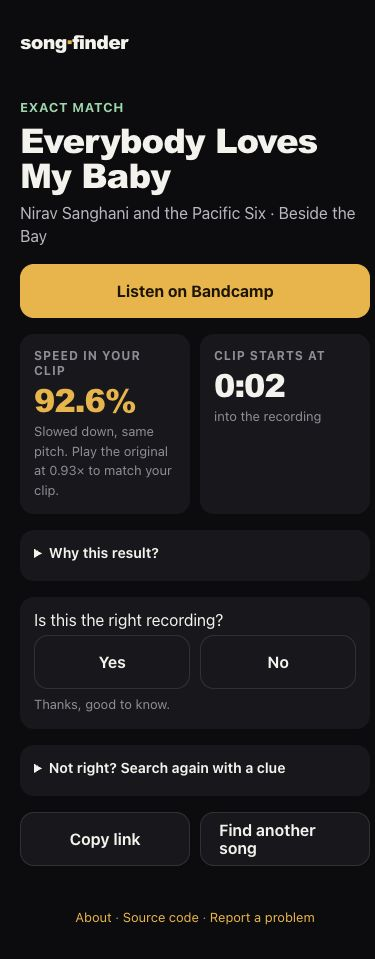

# song·finder

**Find the exact recording behind a video or audio clip, even when it has been slowed down or sped up.**

[Try song·finder → songfinder.andi.sh](https://songfinder.andi.sh)

[](https://github.com/anopows/songfinder/actions/workflows/tests.yml)
[](https://songfinder.andi.sh)

<p align="center"></p>

The screenshot uses a public sample. No visitor recordings are included in this repository.

Upload a video or audio recording. Songfinder compares musical passages with candidate
recordings and returns listening links, the speed used in your clip, and where it starts
in the recording. No account is needed.

It is useful when knowing the song title is not enough: another performance, cover,
live version, or reissue can sound similar but be a different recorded performance.

- **Video or audio:** uploads up to 500 MB; analyses the first ten minutes.
- **Speed-aware matching:** searches both pitch-preserving tempo changes and changes
  where pitch moves with playback speed.
- **Spotify first when confirmed:** other listening sources include Apple Music,
  Bandcamp, YouTube, Deezer, SoundCloud and Internet Archive. The available links
  depend on the recording and evidence.
- **Evidence-aware results:** exact and likely matches are distinguished. A
  recognizer's title suggestion is checked against audio before being accepted.
- **Saved results:** keep an unlisted result link, return later, and leave feedback.
- **Retry without uploading again:** the original browser can edit the title or performer
  and reuse retained audio for up to 14 days. Cancel a queued or running search.

## Use the website

1. Open **[songfinder.andi.sh](https://songfinder.andi.sh)**.
2. Choose your file, add a title or performer if you know it, then press **Find the song**. About 20 seconds of music is enough.
3. Keep the result link while the search runs. A search can take up to six minutes;
   time spent waiting in the queue is additional.
4. Listen to the proposed recording and use **Yes / No** to give feedback. Use **Search again** to try a different clue without uploading again.

A match identifies a recorded performance; it does not promise a particular mastering,
pressing, audio quality, or availability in your country. Difficult clips can remain unresolved.

[Privacy, retention and operating limits](docs/hosting.md#data-and-limits).

## Run locally

Use Python **3.12**, [uv](https://docs.astral.sh/uv/getting-started/installation/), and FFmpeg.

```sh
git clone https://github.com/anopows/songfinder.git
cd songfinder
uv venv --python 3.12
uv pip install --python .venv/bin/python -r requirements-web.lock -e . pytest
```

Compare directly with a reference recording:

```sh
.venv/bin/songfinder match my-clip.mp4 reference.mp3
```

Discover a recording online, then verify it:

```sh
.venv/bin/songfinder identify my-clip.mp4 --shazam --audd
.venv/bin/songfinder identify my-clip.mp4 --title "Everybody Loves My Baby"
```

Optional credentials can be placed in `.env`: `SPOTIFY_CLIENT_ID`,
`SPOTIFY_CLIENT_SECRET`, and `AUDD_API_TOKEN`. Do not commit that file.
Recognition adapters and reference providers have their own availability and terms.
The Shazam adapter is unofficial; discovery can fail when services throttle requests.

For the web application and deployment instructions, see [Hosting](docs/hosting.md).
The public entry points are `songfinder.api` and `songfinder.worker`; presentation helpers are separate from the HTTP boundary.

## Development

```sh
.venv/bin/python -m pytest tests -q
node --test tests/frontend.test.cjs
```

Tests generate synthetic audio and use mocked network boundaries. They do not require
private recordings, provider credentials, or live recognition calls. CI runs the same suite.

The core matcher, CLI, public API, separate queue worker, and deployment templates are
included. Private datasets, reference caches, credentials, and historical debug reports
are excluded. The first public commit is a clean snapshot of the deployed implementation.

See the [v0.2.0 release validation and known limits](docs/release-v0.2.0.md),
[How matching works](docs/matching.md) and the [improvement roadmap](docs/roadmap.md).
Report reproducible problems in [GitHub Issues](https://github.com/anopows/songfinder/issues);
please avoid posting private recordings, result URLs, credentials or personal information.

Maintained by [anopows](https://github.com/anopows).

## Public-launch foundations

Version 0.3 adds externally configured Terms, Privacy and Legal Notice pages, result-removal contact links, encrypted off-host database backup jobs and public health probes. Provider daily caps of zero disable recognition calls without waiting. See [hosting](docs/hosting.md) for configuration and release gates. These changes alone do not establish legal approval, calibrated moderation or a completed production rollout.
