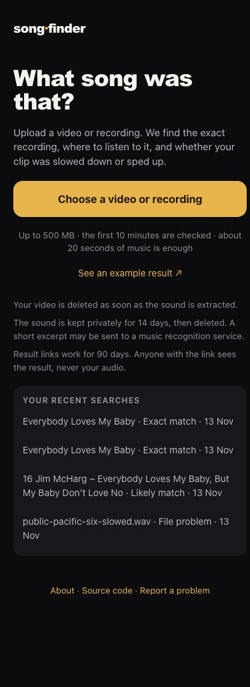
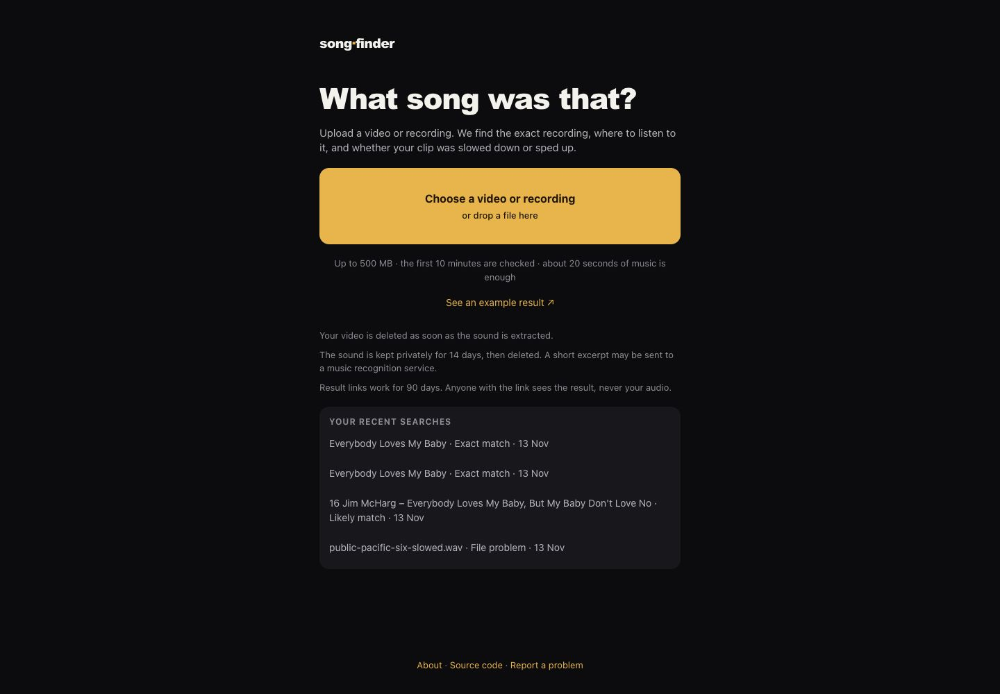
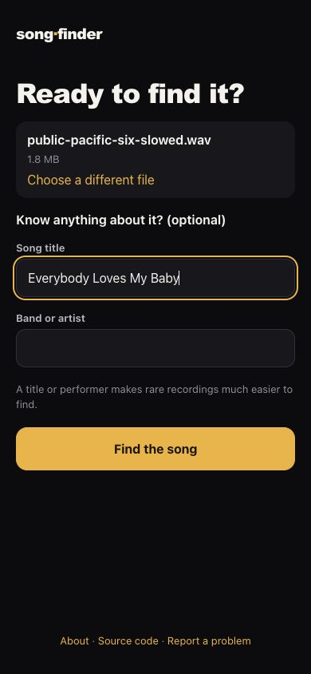
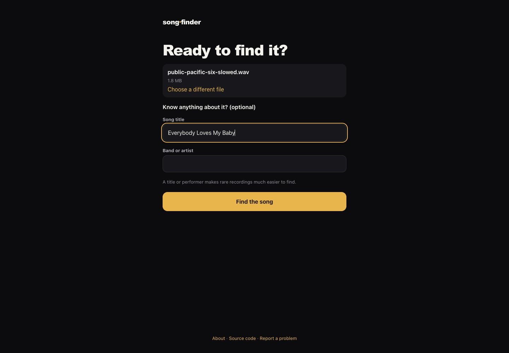
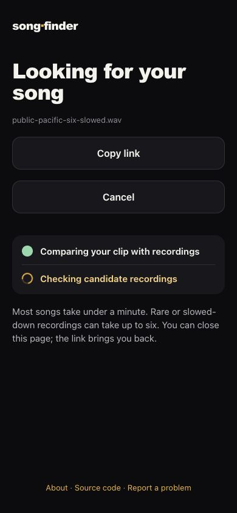
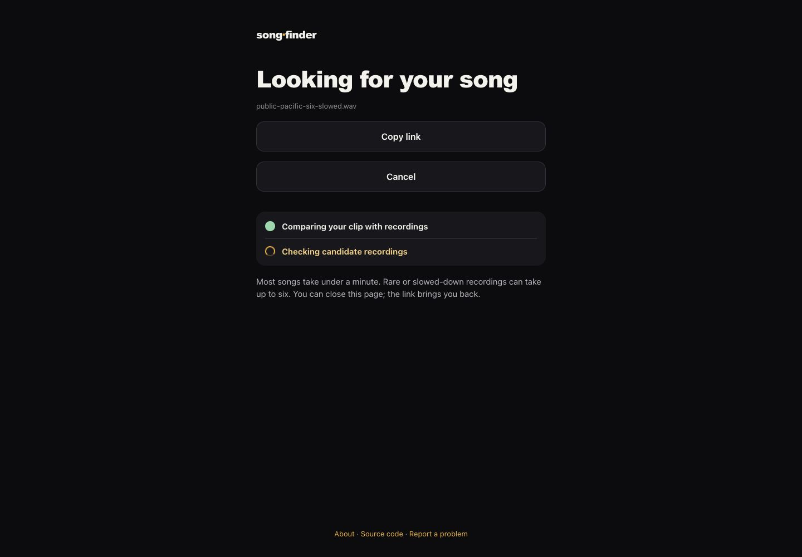
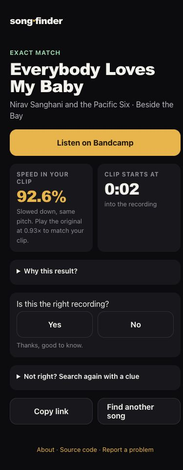
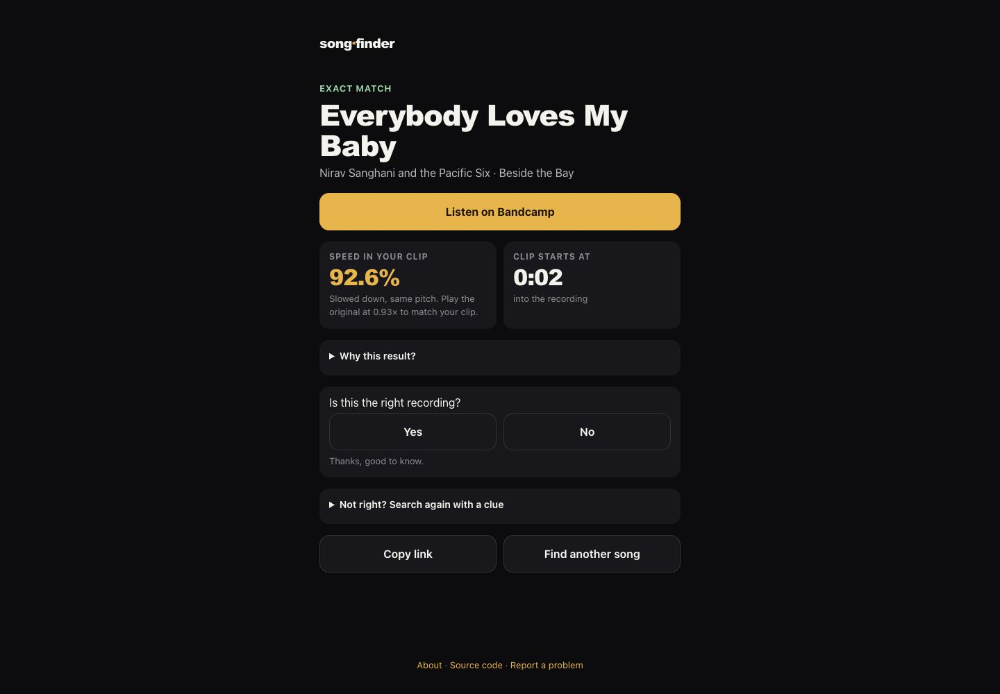
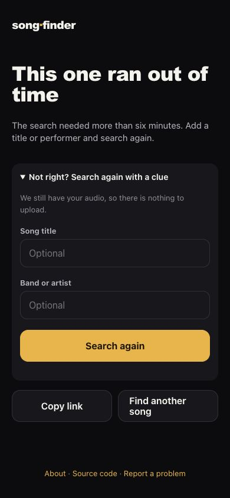
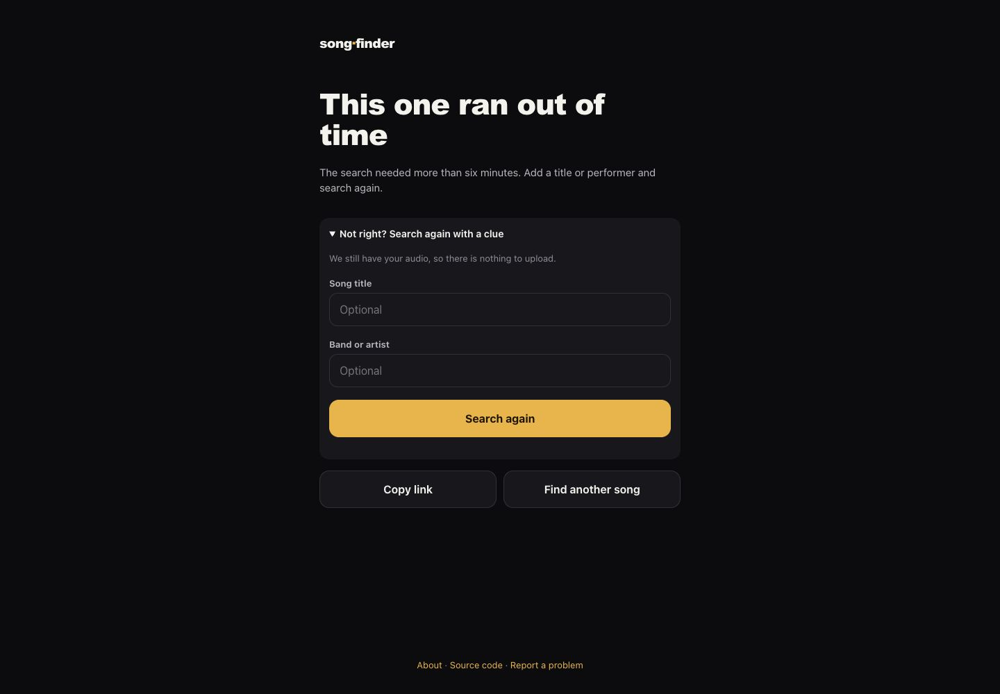

# Live v0.2.0 screenshots

Captured on songfinder.andi.sh in Chrome at measured 390 × 844 and 1440 × 1000 CSS viewports. All displayed clips are public samples or generated test audio. The timeout state is a real completed search.

| Page | Phone width | Desktop width |
| --- | --- | --- |
| Homepage |  |  |
| Confirm the file and add clues |  |  |
| Search progress |  |  |
| Exact match |  |  |
| No match: timeout with retained-audio clues |  |  |
